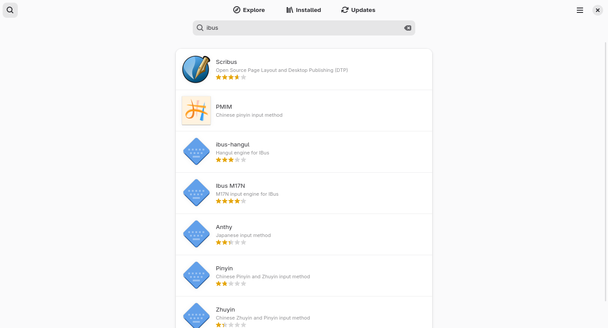
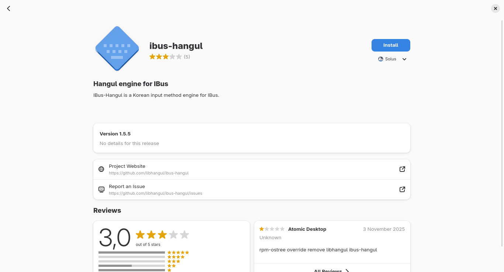
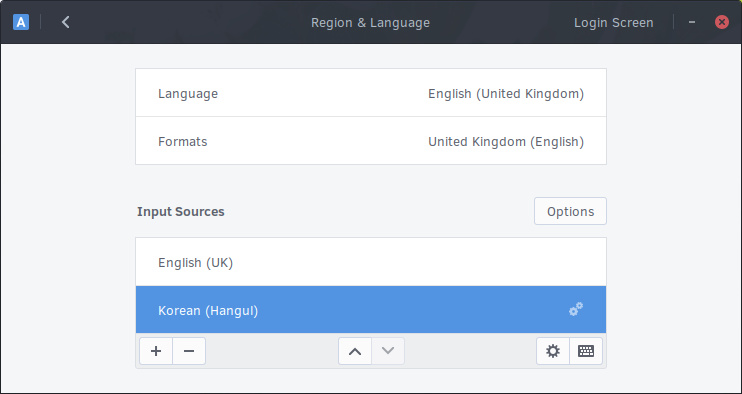
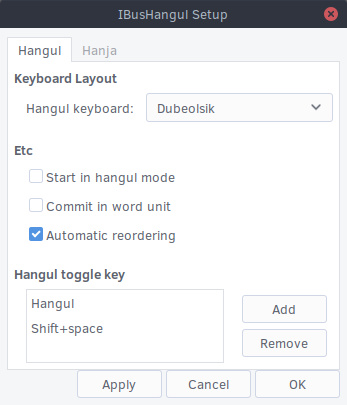

# IBus

## Configuration

- Find the IME (Input Method Editor) you require from the [IBus IME package list](#ibus-ime-package-list) and then search for it in your software center. Click "Install" to add the IME.
- You may have to agree to install some additional dependencies and will need to type in your user password as authentication is required.
- If the IME you require is not listed in the software center, you can istall it by running the following command:

  ```bash
  sudo eopkg install ibus-libpinyin
  ````

---



---



---

Once it has finished installing, logout of your computer and then login again. Now you'll be able to select the newly installed IME by following the same steps as detailed above for changing keyboard layouts in Budgie. For instance, in this example we have installed the `ibus-hangul` package for the Korean language. By following the steps above and then searching for Korean keyboard layouts, we are now able to select Korean (Hangul) as an input source.



Additionally, once you have added the IME and have it selected in the Region & Languages window, you can click on the cog icon under the input sources to load the settings window for your specific IME. The `ibus-hangul` settings window is shown below but this will vary between the different IME's.



## IBus IME package list

A list of IBus IME packages available in the Solus software repository.

| Package        | Input Method                                        |
| -------------- | --------------------------------------------------- |
| ibus-anthy     | Japanese                                            |
| ibus-chewing   | Phonetic Chinese input method for Zhuyin (Bopomofo) |
| ibus-hangul    | Korean                                              |
| ibus-m17n      | Multiple Languages                                  |
| ibus-unikey    | Vietnamese                                          |
| ibus-libpinyin | Chinese Pinyin and Bopomofo                         |
| ibus-libzhuyin | Chinese Zhuyin                                      |
| ibus-cangjie   | Simplified Cangjie                                  |
